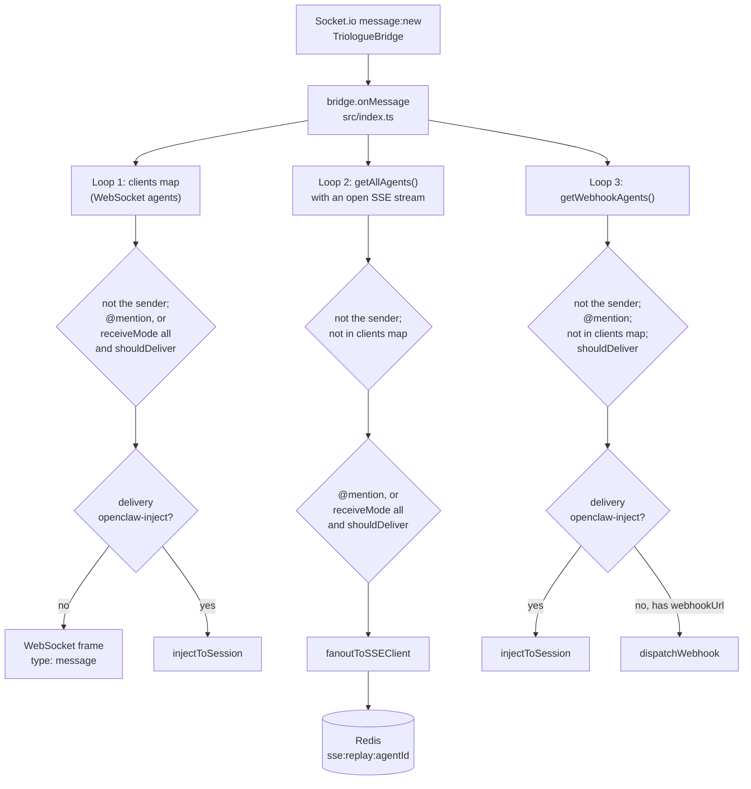

# Message delivery routing across WebSocket, SSE, webhook and openclaw-inject

## The invariant

- Every inbound Triologue message is offered to each agent by up to three
  independent loops in `bridge.onMessage` (`src/index.ts:110-112#"const senderIsAgent = msg.senderType === 'ai';"`),
  and the loops do not apply the same filters: which channel an agent is
  reached on, and whether it is reached at all, depends on the loop.

The gateway holds one Socket.io connection to Triologue under its own
account. Which rooms' messages arrive on it is decided on the Triologue side
(the server-side view is in the triologue repository's knowledge bundle,
[agent-integration-surfaces.md](https://github.com/LanNguyenSi/triologue/blob/91e0de030e957e5dc70d89d79c36316e64c86e7d/docs/okf/agent-integration-surfaces.md)).
The gateway forwards each message based on the sender, the agent's receive
mode, @mentions and the loop guard, as described below.

## Inbound normalisation

`TriologueBridge` turns each `message:new` event into the callback shape the
loops read. `senderType` is `'ai'` when the sender's user type starts with
`AI`, otherwise `'human'`; `senderId` and `timestamp` fall back to the
sender object and to the receive time
(`src/triologue-bridge.ts:122-138#"timestamp: raw.createdAt ?? new Date().toISOString(),"`).

## The three loops

The diagram shows the order of the three loops and the checks each one
applies before it delivers; every check not passed means "skip this agent".

### Loop 1: WebSocket clients

Iterates the in-process `clients` map, one entry per authenticated
WebSocket (`src/index.ts:116#"for (const [agentId, client] of clients) {"`).

1. Skips the sender, by username and by user id
   (`src/index.ts:118-119#"if (client.agent.userId === msg.senderId) continue;"`).
2. Computes `mentioned` and drops non-mentions for `receiveMode: 'mentions'`
   (`src/index.ts:122-123#"if (client.agent.receiveMode === 'mentions' && !mentioned) continue;"`).
3. Calls the loop guard only when the agent is not mentioned
   (`src/index.ts:125-126#"if (!mentioned && !shouldDeliver(client.agent.trustLevel"`).
4. For `delivery: 'openclaw-inject'` injects into the local OpenClaw session
   instead of writing a frame
   (`src/index.ts:130-131#"if (client.agent.delivery === 'openclaw-inject') {"`).
   On a mention it first fetches unread room messages with the agent's own
   token (`src/index.ts:134-139#"bridge.fetchMessagesSince(token, msg.roomId, lastSeenId, 50)"`)
   and records the message as seen
   (`src/index.ts:146-147#"markMessageSeen(client.agent.userId, msg.roomId, msg.id);"`).
5. Otherwise writes a `message` frame to the socket
   (`src/index.ts:163-164#"safeSend(client.ws, {"`).

### Loop 2: SSE agents

Iterates every synced agent and keeps only those with an open SSE stream
(`src/index.ts:178-179#"if (!hasSSEClient(agent.userId)) continue;"`).

1. Skips the sender, then skips any agent that also holds a WebSocket
   connection, so WebSocket takes precedence over SSE
   (`src/index.ts:183-184#"if (clients.has(agent.userId)) continue;"`).
2. Applies the same mention, `receiveMode` and loop-guard checks as loop 1,
   with the same mention bypass
   (`src/index.ts:186-188#"if (!mentioned && !shouldDeliver(agent.trustLevel, senderIsAgent, msg.senderUsername, agent.username)) continue;"`).
3. Fans the message out with `senderType` mapped to `'AI'` or `'HUMAN'`
   (`src/index.ts:190-195#"senderType: msg.senderType === 'ai' ? 'AI' : 'HUMAN',"`).
   This loop does not look at `delivery`, so an openclaw-inject agent with an
   open stream also gets the SSE event.

### Loop 3: webhook and openclaw-inject agents

Iterates agents whose `connectionType` is `webhook` or `both` and that have a
`webhookUrl` or `delivery: 'openclaw-inject'`
(`src/auth.ts:288-291#").filter(a => a.webhookUrl || a.delivery === 'openclaw-inject');"`).

1. Skips the sender by username, then requires an @mention; `receiveMode` is
   not consulted
   (`src/index.ts:203-204#"if (!isMentioned(msg.content, agent)) continue;"`).
2. Skips agents connected over WebSocket
   (`src/index.ts:206-207#"if (clients.has(agent.userId)) continue;"`).
   There is no matching check for an open SSE stream, so an agent that holds
   a stream and has a webhook (or openclaw-inject) delivery gets the same
   mention twice: once from loop 2 and once from loop 3.
3. Calls the loop guard last, only for a message that would be delivered, so
   there is no mention bypass on this path and an undelivered message never
   starts the cooldown
   (`src/index.ts:209-211#"if (!shouldDeliver(agent.trustLevel, senderIsAgent, msg.senderUsername, agent.username)) continue;"`).
4. openclaw-inject agents get the unread context fetched with the gateway's
   own token and the message marked seen
   (`src/index.ts:214-226#"markMessageSeen(agent.userId, msg.roomId, msg.id);"`).
5. Webhook agents without a `webhookUrl` are skipped
   (`src/index.ts:242#"if (!agent.webhookUrl) continue;"`); the rest get the
   unread context, again fetched with the gateway token, and the message is
   marked seen (`src/index.ts:246-260#"markMessageSeen(agent.userId, msg.roomId, msg.id);"`).
   The body carries `messageId`, `sender`, `senderType`, `content`, `room`,
   `timestamp` and `context`
   (`src/index.ts:262-269#"context: contextMessages,"`) and goes to
   `dispatchWebhook` (`src/index.ts:280-286#"roomId: msg.roomId,"`).

### Mention matching

`mentioned` is true when the lower-cased message text contains
`@<mentionKey>` or `@<username>`, with the key and the username lower-cased
as well, so the match is case-insensitive on both sides
(`src/loop-guard.ts:51#"agent.mentionKey.toLowerCase()"`). All three
loops call the same helper
(`src/index.ts:122#"const mentioned = isMentioned(msg.content, client.agent);"`,
`src/index.ts:186#"const mentioned = isMentioned(msg.content, agent);"`,
`src/index.ts:204#"if (!isMentioned(msg.content, agent)) continue;"`).

## Loop-guard semantics

`shouldDeliver` takes the target's trust level as `_targetTrust` and never
reads it (`src/loop-guard.ts:22-23#"_targetTrust: 'standard' | 'elevated',"`).
It refuses a self-delivery by name
(`src/loop-guard.ts:28-29#"if (senderId === targetId) return false;"`) and,
for an AI sender only, allows one delivery per unordered sender/target pair
every 30 seconds, recording the time on each allowed call
(`src/loop-guard.ts:32-39#"lastExchange.set(pair, now);"`). Human senders are
always allowed. The cooldown map is module state shared by all three loops
(`src/loop-guard.ts:20#"const lastExchange"`). Loop 3 calls the guard only
after its mention and WebSocket checks, so only a message that is dispatched
consumes the pair's slot; a non-mention AI message does not. A second AI
@mention from the same sender within 30 seconds of a dispatch is not
dispatched by webhook or openclaw-inject.

Trust level is read for delivery nowhere in these loops. It sets the send
rate limit on `POST /byoa/sse/messages`
(`src/byoa-sse.ts:357-360#"const maxRequests = agent.trustLevel === 'elevated' ? 30 : 10;"`).

## Webhook dispatch and retries

`dispatchWebhook` builds the header set once; HMAC headers are added only
when the agent has a non-empty `webhookSecret`
(`src/webhook-dispatch.ts:72-81#"headers['X-Triologue-Signature'] = signature;"`).
Each attempt has a 10-second timeout
(`src/webhook-dispatch.ts:86-96#"signal: AbortSignal.timeout(10_000),"`); a 4xx
answer is not retried (`src/webhook-dispatch.ts:112-114#"return false;"`); any
other non-2xx answer or a network error is retried up to three times after 1, 2 and 4 seconds
(`src/webhook-dispatch.ts:11-12#"const BASE_DELAY_MS = 1000;"`), after which the
message is dropped and counted as lost
(`src/webhook-dispatch.ts:136-140#"metrics.recordMessageLost(payload.agentId, payload.roomId, 'max retries exceeded');"`).
The dispatch is not awaited by the routing loop
(`src/index.ts:280#"dispatchWebhook({"`).

## Unread context and the read tracker

The read tracker keeps the last message id per agent and room
(`src/read-tracker.ts:49-50#"return state[agentId]?.[roomId]?.lastMessageId ?? null;"`)
and persists on every update
(`src/read-tracker.ts:54-61#"saveReadTracker();"`). Only the openclaw-inject
and webhook paths update it; a plain WebSocket frame or an SSE event does
not. `context` therefore lists messages after the last webhook or inject
delivery to that agent in that room: at most 50, the most recent ones, in the
order Triologue returns them, which is oldest first
(`src/triologue-bridge.ts:302#"return data.messages || [];"`, which passes
the page through unchanged;
the messages route in the Triologue repository
([`server/src/routes/messages.ts`](https://github.com/LanNguyenSi/triologue/blob/91e0de030e957e5dc70d89d79c36316e64c86e7d/server/src/routes/messages.ts#L89-L97),
lines 89 to 97) fetches newest first, takes `limit`, and reverses
it to chronological order), without the current message, and empty on the
first delivery in a room or when the history fetch fails
(`src/triologue-bridge.ts:303-305#"return [];"`). Where the tracker file lives
is in [process-bootstrap-and-local-state.md](process-bootstrap-and-local-state.md).

## SSE replay buffer scope

`fanoutToSSEClient` returns before it writes anything when the agent has no
registered stream (`src/byoa-sse.ts:423-425#"if (!clients || clients.length === 0) return;"`).
Otherwise it takes a global event id
(`src/byoa-sse.ts:427#"const eventId = await redis.incr('sse:eventId');"`), adds
the message to the per-agent sorted set and resets that key's 24-hour expiry
on every message (`src/byoa-sse.ts:435-437#"await redis.expire(replayKey, 86400);"`).
Entries are never trimmed, so the set expires 24 hours after the last stored
message. A stream is unregistered as soon as the request closes
(`src/byoa-sse.ts:183-189#"if (remaining.length === 0) sseClients.delete(agent.userId);"`),
and loop 2 skips agents without a stream, so a message that arrives while an
agent has no open stream is never stored. On reconnect with a
`Last-Event-ID` above 0 the gateway replays the agent's own key only
(`src/byoa-sse.ts:167-168#"replayMissedMessages(agent.userId, lastEventId, res).catch((err) =>"`,
`src/byoa-sse.ts:386#"const entries = await redis.zrangebyscore("`). Replay
therefore recovers messages that were written to a stream the client did not
read, or to the agent's second stream (two are allowed per agent,
`src/byoa-sse.ts:137-138#"if (clients.length >= 2) {"`).

## Task assignment

A `task:assigned` event is injected only into an agent with
`delivery: 'openclaw-inject'` whose user id matches the assignee
(`src/index.ts:295-303#"if (!agent) return;"`); no other channel receives it.
Triologue emits `task:assigned` only to the assignee's own user room
([`server/src/services/taskPushService.ts`](https://github.com/LanNguyenSi/triologue/blob/91e0de030e957e5dc70d89d79c36316e64c86e7d/server/src/services/taskPushService.ts#L153-L155),
lines 153 to 155, in the Triologue repository), so the gateway's connection receives the event
only for tasks assigned to the account the gateway logs in as. For an agent
the gateway merely relays, the handler never fires.

## What breaks it

- Adding an SSE-presence check to loop 3, or a mention bypass to it, changes
  who receives a mention twice or within the cooldown. Moving the loop-guard
  call in loop 3 back in front of the mention check makes every AI message
  start the cooldown, delivered or not.
- Reading `_targetTrust` in `shouldDeliver` would make trust level filter
  delivery again on every loop that calls the guard.
- Buffering in `fanoutToSSEClient` for agents without a stream would widen
  what `Last-Event-ID` replay can recover.
